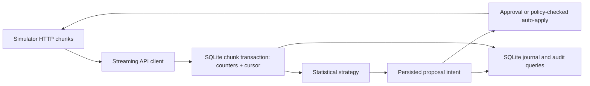

# Outcome-First Agent Loop — Submission

Name: Gitesh Pareek · Date: 2026-11-10 · Hours actually spent: about 0.75 h in this implementation session (update after personal review) · Language / storage: Python 3.12 / SQLite WAL

## 0. TL;DR

The controller streams simulator events into a durable aggregate store, detects caller-ID and hallucination incidents, runs a bounded voice experiment, and applies only governed changes. `public_01` finished with +0.5% aggregate conclusion rate and four neutral changes. `public_02` finished with +8.1% aggregate conclusion rate, three beneficial and no harmful changes, and a 255-minute bad-prompt time to fix. I cut new cohorts, individual call-time optimization, a supervisor UI, and a distributed stack.

## 1. Assumptions

1. The simulator stays alive while the controller restarts; this is its documented contract. A new simulator world resets local state when its minute moves backwards.
2. A QA hallucination flag is noisy; at least 200 connected calls and 10 flags are needed before response. A prior prompt or older window supplies a reference when available.
3. A 5% exploration arm is an acceptable reversible exposure on `mid_flight: allowed` workflows. `next_campaign_only` defers agent-facing changes by simulator contract.
4. A proposal's `affected_leads` is a two-day batch estimate, not an exact count of eligible leads. Exploration's `impact_score=0.05` represents value of information, not predicted KPI lift.
5. A validated prompt is safer on synthetic QA only. It may still hurt engagement; the present controller does not claim validation proves business lift.
6. The default `runs/controller.sqlite` is reused only for restarts of one active run; a new world at an earlier minute triggers reset. Set `CONTROLLER_DB` explicitly for concurrent runs.

## 2. Scope decisions

| Capability | Status | Why | To finish |
|---|---|---|---|
| C1 ingestion | Built | Foundation for fresh, restartable decisions | Partition at production scale |
| C2 shared cohorts | Partial | Uses simulator cohort IDs; no new feature joins | Lead feature index and cohort compiler |
| C3 history bootstrap | Built | History chunks are ingested before D0 decisions | Tune retention |
| C4 call time | Cut | Per-person evidence and schedule risk need separate design | Person-hour joins and safe exploration |
| C5 caller ID | Built | Detects a significant 24h pickup gap and shifts at most 20 points | Decay-aware re-exploration |
| C6 welcome/voice | Partial | Sequential 95/5 tests, global default only | Cohorts, interactions, fixed looks |
| C7 decay/rollback | Partial | Removes a significantly losing or guardrail-breaking arm | Durable winner decay and rollback state machine |
| C8 hallucinations | Partial | Detect, suggest, validate, approve and apply | Automated post-apply guardrail rollback |
| C9 governance | Built | Approval, auto-apply, policy limit, stale, expiry and lapse handling | Multi-change batching |
| C10 impact/dry run | Partial | Counts and observed rates are included; replay is explicitly non-causal | Matched historical replay |
| C11 supervisor view | Cut | Audit CLI is available; UI adds little to hidden outcome score | Read model/API |
| C12 audit | Built | SQLite intent and append-only journal | Long-term retention and customer lookup |
| C13 crash recovery | Built | SIGKILL/restart demonstrated | Fault injection at every network boundary |
| C14 observability | Partial | Progress JSON: timestamp, cursor, events, wall time, credits | Metrics endpoint and alert routing |
| C15 tenant fairness | Cut | One process and low credit use in public runs | Per-tenant quotas |

The selection principle was to make the governance and recovery foundation trustworthy, then spend the remaining time on interventions with direct incident evidence.

## 3. Stakeholders

### 01 — Sales

Accepted: fast approval polling and a clear per-workflow outcome. Declined: a blended pickup/engagement score, unapproved customer-facing changes, and cross-client prompt rollout. Wrong claims: Kestrel's auto-apply excludes prompts and limits allocation shifts; Northwind KYC has auto-apply disabled.

Reply: “I can show each client's conclusion rate alongside its separate pickup and engagement rates. The incident run improved Kestrel's conclusion rate by 26.0% versus baseline, with no harmful controller changes. We will not roll a prompt across accounts or bypass the client's approval policy. The quickest safe path is a small experiment, evidence, then a scheduled approval.”

### 02 — Northwind Compliance

Accepted: approval for customer-facing changes, validation evidence for prompts, and a queryable variant/config journal. Declined: claiming a 24-hour customer-level trace from aggregates alone. Wrong assumption: KYC operational settings are not auto-applicable under its live policy; renewal permits schedule and caller ID auto-apply only.

Reply: “Northwind voice, greeting and prompt changes go to your named approver. The request includes the exact config diff and evidence; prompt changes require a passing validation run. We keep config-version and proposal records, but this prototype does not retain a customer-level call ledger. That lookup must be added before an auditor-facing launch.”

### 03 — Platform/SRE

Accepted: kill/restart verification, idempotency, and measurable load. Declined: adding Redis or a queue to the submission. The memo's production clock warning is correct; the simulator's manually advanced clock is a test convenience.

Reply: “SQLite WAL holds the cursor, aggregates and proposal state. A killed controller resumed and finished with no duplicate config applications in the checked run. On public_03, 9.74 million events were processed in 48.4 seconds with about 41.5 MB peak resident memory on this Mac. Production should move this state to existing Postgres, partition by workflow, and page only on sustained ingest lag, approval reconciliation failures or credit exhaustion during an incident.”

### 04 — Kestrel Operations Supervisor

Accepted: supervisor versions are never silently overwritten; Kestrel approvals start no earlier than 11:00. Declined: a UI and pre-change notification in this submission. Policy mismatch: simulator permits four approval requests per 24h, whereas the memo asks for two; observed public runs used at most one.

Reply: “Your edits remain authoritative. If the version changes after we propose, the controller marks that proposal stale and reevaluates the current config. Prompt changes still require approval. I have kept requests low in the public runs, but the one-screen view and advance notice for auto-applied changes need a product surface before live use.”

### 05 — Product

Accepted: separate KPI denominators, shared simulator cohort IDs, real-event evidence, and workflow-local changes. Declined: per-person timing and the consolidated screen. Correction: an expired proposal is a distinct lifecycle state; it should be reevaluated with fresh evidence rather than treated as the same decision as a human rejection.

Reply: “The 95/5 test requires 150 connected calls in each arm and a conservative statistical threshold. The current system uses existing cohort IDs but does not create new segments. A proposal includes an observed-rate dry run and labels uncertain projections honestly. I would put feature joins and the consolidated view next, after the core loop's post-change monitoring is stronger.”

### 06 — CTO

Accepted: scope discipline, credit conservation, and operational ownership. Declined: a broad but shallow feature list. No specific false policy claim in this memo; it correctly asks us to check the other memos against live policy.

Reply: “This submission spends eight credits in the incident scenario and zero in the clean scenario. Its durable loop and measured load are strong foundations, while cohort optimization and post-apply rollback remain explicit gaps. I would not ship it to regulated customers next month without customer-level audit retention, fixed-look experiment design, and a production incident runbook.”

## 4. Architecture



`controller/api.py` handles transport; `store.py` owns WAL transactions; `stats.py` contains the deterministic tests; `strategy.py` constructs candidates; `governance.py` reconciles proposal states; `loop.py` advances time and ingests missing chunks. On restart, the controller lists all chunks after its committed cursor. A prepared proposal is rediscovered by `proposal_id` from `/approvals`; an uncertain auto-apply is checked against config history. `run.sh` needs one simulator URL; `CONTROLLER_DB` and `PYTHON` are optional overrides.

## 5. The learning loop

The controller preserves the simulator's cohort IDs and tests only the default allocation. History is ingested before D0. For an engagement-primary workflow, it explores one untried voice, then welcome message, at 5% share after 200 baseline connected calls. It compares only default-cohort calls under the same config version; welcome and voice interactions are not estimated. A promotion initially keeps a 20% holdout, which may later be removed if it underperforms or breaches the guardrail.

Winner selection uses separate engagement numerators/denominators and a pooled two-sided z score >=3.29 with >=150 connected calls per arm. That threshold has roughly 0.1% false-positive probability **per independent look** under the null. Repeated hourly looks and multiple variants are not yet corrected, so no familywise rate is claimed. A promotion also requires its pickup point estimate to stay within the workflow's two-point guardrail. A losing or guardrail-breaking arm is removed. Caller-ID comparisons use connected/dials, >=200 dials per ID, a 24h window, and a check that engagement does not fall beyond its guardrail; shifts are limited to 20 allocation points. No call-time change is made. Long-term decay rollback remains cut.

## 6. Governance

The local intent state is `prepared → pending → applied | rejected | expired | lapsed | stale`. It is persisted before the HTTP request. Approved changes apply only when the base version still matches; after a supervisor edit they are marked stale. Expiry and lapse free the workflow for a fresh proposal. Approval submissions respect the policy's rolling 24h cap and normal proposals have a six-hour cooldown. The controller checks the actual `allowed_dims` and total-variation `max_shift` before auto-apply; permitted auto changes can run outside approver hours. Kestrel human approval requests start at 11:00; others use their policy hours. One proposal at a time avoids overwriting an in-flight change but does not batch distinct dimensions.

`affected_leads = 2 × daily_batch.size` is a coarse two-day estimate. Caller-ID impact is the observed pickup gap times the proposed traffic shift. Prompt impact is recent QA flag prevalence. Exploration's 0.05 score is value of information; none is a causal lift forecast. Dry runs contain observed counts and explicitly label historical replay non-causal.

## 7. Incidents

The detector requires >=200 connected calls, >=10 QA flags in six hours, a >=2-point increase against history/another prompt, and z >=3.29; without a reference it requires >=6% flags. A detected incident spends three credits on LLM suggestions, then five on a 500-conversation validation. It rereads the live credit balance before each paid call and does not retry ambiguous paid POSTs. Grounded suggestions are tried before strict scripts, and the live policy's minimum pass rate must be met. The candidate still goes through approval. In `public_02`, Kestrel's supervisor changed the prompt at D3 11:30; detection and validation occurred at D3 14:00; approval applied P3 at D3 15:45. Grader MTTR was 255 minutes. Post-apply QA fell, but automated engagement rollback is not built.

## 8. Scale

See `reports/public_03_load.md`. On Apple Silicon with the simulator and controller on one host, the controller processed 9,737,610 events in 48.4 wall seconds including history (~201k events/s overall), with 41.5 MB peak resident size. After bootstrap, each simulated day took about 6–8 wall seconds. This is not a 4-vCPU Linux measurement, so it is a directional result. The decision loop reacts within one simulated hour (15-minute ticks while an approval is pending). At 10×, one SQLite writer, Python JSON decoding and simulator HTTP serialization will become limits. Partition by workflow/tenant, stream through an existing queue, and keep the decision state in Postgres; preserve one owner per workflow.

## 9. Reliability

`reports/crash_recovery.md` records a SIGKILL at minute 645, restart to the final minute, no pending intents, no duplicate config applications, and two applied intents matched in config history. Chunk counters and cursor commit together. Proposal IDs are persistent idempotency keys. Transport errors retry with backoff for idempotent reads; paid LLM/validation POSTs are sent once to avoid accidental credit duplication. Uncertain advance responses are checked against `/sim/state` before another advance. A 409 on apply or a stale submission marks stale, 410 marks lapsed, and policy 403 on auto-apply is journaled as rejection. Unhandled 5xx eventually stops the process so it can be restarted with the same DB.

## 10. Audit & observability

For the `ks_cancel` prompt change, query the controller's own SQLite store:

```sql
SELECT created_ts, status, approval_id,
       json_extract(body,'$.rationale') AS why,
       json_extract(body,'$.evidence.validation_run_id') AS validation
FROM intents
WHERE workflow='ks_cancel'
  AND json_extract(body,'$.proposed_config.prompt_version')='P3';
```

Actual row: `2027-01-07T14:00:00+05:30 | applied | apr_00002 | 21/247 QA flags in 6h; validation 0.988/500 | val_00001`. The journal has `incident_detected` and `validation` at 14:00 and `proposal_applied` at 15:45. JSON progress lines expose cursor, events ingested, wall time and credits. Production pages: sustained ingest lag, unreconciled approved proposal near `apply_by`, and low credits during a detected incident. Routine rejected experiments and neutral outcomes belong in a daily review, not a page.

To see what followed from the controller's own counters:

```sql
SELECT version, variant, SUM(connected), SUM(engaged), SUM(hallucinations)
FROM counts
WHERE workflow='ks_cancel' AND dimension='prompt_version' AND version IN (5,6)
GROUP BY version, variant ORDER BY version;
```

Actual rows: `v5 P2: 347 connected, 155 engaged, 31 QA flags`; `v6 P3: 5,940 connected, 3,097 engaged, 79 QA flags`. These are observed periods, not a causal experiment.

## 11. Results

From `reports/public_01.md`:

| workflow | conclusion rate | Δ | pickup | Δ | engagement | Δ | engagement gap captured | hallucinated calls (base) |
|---|---|---|---|---|---|---|---|---|
| ks_cancel | 0.345 | +1.0% | 0.246 | +0.6% | 0.494 | +0.3% | 0% | 64 (57) |
| nw_kyc | 0.370 | +1.0% | 0.243 | +0.5% | 0.599 | +0.4% | 0% | 19 (21) |
| nw_renewal | 0.414 | -0.5% | 0.264 | +0.1% | 0.539 | -0.5% | 0% | 52 (54) |
| ALL | 0.374 | +0.5% | 0.252 | +0.4% | 0.530 | +0.0% | 0% | 135 (132) |

Four neutral exploration changes, no harmful changes. The conservative global experiment did not capture heterogeneous engagement headroom.

From `reports/public_02.md`:

| workflow | conclusion rate | Δ | pickup | Δ | engagement | Δ | engagement gap captured | hallucinated calls (base) |
|---|---|---|---|---|---|---|---|---|
| ks_cancel | 0.297 | +26.0% | 0.203 | +12.0% | 0.512 | +9.5% | 39% | 87 (348) |
| nw_kyc | 0.363 | -2.9% | 0.239 | +1.9% | 0.581 | -4.5% | 0% | 24 (29) |
| nw_renewal | 0.437 | +0.9% | 0.267 | +1.8% | 0.549 | -0.9% | 5% | 63 (54) |
| ALL | 0.358 | +8.1% | 0.232 | +5.7% | 0.541 | +1.5% | 18% | 174 (431) |

Six applied: three beneficial, three neutral, zero harmful by hidden-truth grader. Kestrel's caller ID and prompt response drive most lift. KYC's negative conclusion delta occurred without a controller change to that workflow; it is scenario randomness rather than an attributed harmful intervention. The next improvement should be cohort-specific experiments, not a stronger global push.

## 12. Trade-offs & rejected alternatives

| Option | Why considered | Why rejected / what instead |
|---|---|---|
| Postgres + Redis | Production fit | SQLite is sufficient for a single-process simulator and restart proof |
| Store every lead and call | Customer-level audit and personalization | Aggregate streaming keeps memory bounded; customer lookup is a launch gap |
| LLM selects winners | Easy to implement | Deterministic count-based statistical tests decide |
| Full factorial welcome × voice | Detect interactions | Too much traffic and approver attention; sequential 95/5 tests |
| Auto-apply every permitted change | Faster | Respect shift limits and reserve approval for customer-facing Northwind changes |

## 13. Known weaknesses

- No generated cohorts or per-person timing. Post-promotion decay handling is incomplete; public_01 lift is small.
- Repeated statistical looks are not familywise corrected. The guardrail uses a point estimate, not a confidence bound.
- Prompt validation measures safety, not engagement. The controller has no automatic post-prompt engagement rollback.
- `impact_score` and affected lead estimates are coarse. The dry run is observed historical context, not a causal replay.
- SQLite is single-writer, with no production HA or customer-level retention. No supervisor UI or automatic advance notice exists.
- Recovery is tested at one kill point; an ambiguous validation response can spend credits twice if retried.

## 14. If this went to production at Formi next month

Week 1: move event and proposal state to existing Postgres with workflow ownership leases; add a customer-level, access-controlled call/config ledger; add fixed-look experiment windows and guardrail confidence intervals; add fault injection around every HTTP boundary. Week 2: implement post-apply monitoring and rollback, a supervisor read API with notification before live changes, per-tenant credit/approval budgets, on-call alerts, and a 4-vCPU Linux load test with 10× projections.
